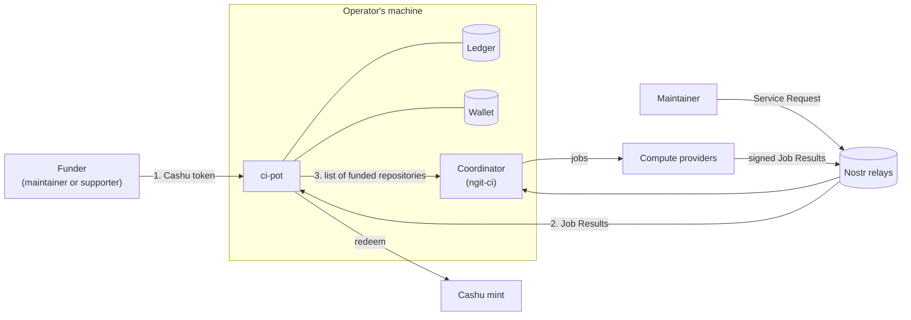
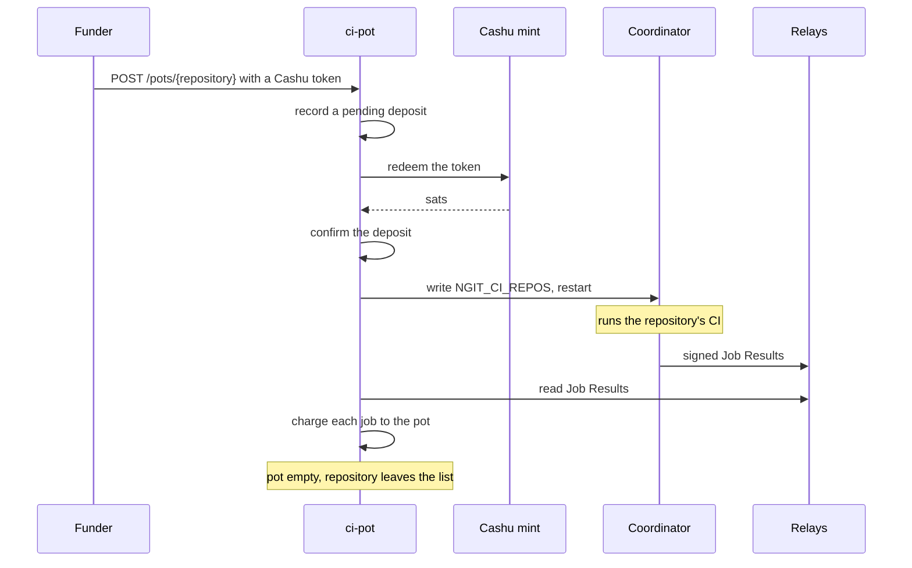

# ci-pot

A funding pot for CI on Nostr. Anyone pays sats into a repository's pot, and a coordinator runs that repository's CI while the pot is funded.

> **Status: a working prototype, not a product.** It has been run with fake money against real job data. It has not yet run beside a live coordinator. It is not affiliated with or endorsed by the ngit project. The name is a working name.

## Why

Projects that host their code on Nostr can run CI through [Grasp CI](https://ngit.dev/protocol/ci) (NIP-C1). A *coordinator* watches a repository and schedules its jobs, *compute providers* run them, and every result is published as a signed event.

Today a maintainer gets CI in one of two ways:

1. run a coordinator and a provider themselves, or
2. find someone who runs one and ask them to add the repository by hand.

ngit's own documentation says so plainly:

> "For v0.2, the main way to get started is to self-host a coordinator and a compute provider for your own repositories."
>
> "There is no automatic hosted-CI signup or payment flow in this release."
>
> — [Use Grasp CI](https://ngit.dev/ci)

The effect shows in the public data. On 25 November 2026, the relays held:

| Measured over the previous 7 days | |
|---|---|
| Repositories with any CI result | 23 |
| Machines that ran CI | 14, most of them only for their owner's repositories |
| Repositories with issues on Nostr git, all time | 412 |

Most repositories have no CI, and most CI machines serve one person.

**The cause is money.** CI costs compute. An operator has no way to be paid for serving a stranger's repository, so there is no reason to offer it. The [ngit roadmap](https://ngit.dev/roadmap) names the missing piece:

> "Maintainers or benefactors could fund additional capacity through a subscription or shared pot... The marketplace, subscriptions and community compute arrangements described here are still to be built."

People are asking for it too. One developer wrote on Nostr in October 2026: "I don't mind paying for CI, I do mind shotgun KYC", and asked for CI "billed by the second".

## Intention

To close that gap: **a maintainer should be able to get CI by paying for it, and an operator should be able to be paid for running it, with no account and no conversation between them.**

Three things follow from that intention:

- **It fits into Grasp CI and does not replace any of it.** It reads the same signed events every client reads and writes the setting the coordinator already has.
- **It is a sketch to learn from.** A prepaid pot per repository is one answer. Pay-per-job through a compute market such as [Loom](https://gitworkshop.dev/npub1hw6amg8p24ne08c9gdq8hhpqx0t0pwanpae9z25crn7m9uy7yarse465gr/relay.ngit.dev/loom-protocol) is another. [PROPOSAL.md](PROPOSAL.md) lists the open questions.
- **Where it should live is open.** If this belongs inside ngit-ci or in the specification, that is a better outcome than a separate tool.

## How it works

`ci-pot` runs beside a coordinator, on the operator's machine. It does three things, and nothing else changes its state.



### 1. Deposit

Anyone pays a [Cashu](https://cashu.space) token into the pot of a repository, named by its NIP-34 address. The token is redeemed at its mint and the pot is credited. No account is needed, and the payer does not have to be the maintainer.

### 2. Settle

`ci-pot` reads the coordinator's Job Results (kind `9841`) from relays and takes each finished job's cost out of the repository's pot:

> cost = running time × vCPUs × the operator's rate

- **Running time** is the event's `created_at` minus its `started_at`, as [NIP-C1](https://ngit.dev/protocol/ci/specification) defines them.
- **vCPUs** come from the result's `f` tag (`vcpus:eq:4`). A job that declares none is charged for the operator's default.
- **The rate** is set by the operator, in sats per vCPU-hour.

A 694-second job on 4 vCPUs at 60 sat per vCPU-hour costs 46.3 sat.

### 3. Admit

`ci-pot` writes the repositories whose pot is funded as `NGIT_CI_REPOS=...`, the setting ngit-ci reads at start-up, and runs a command of the operator's choosing when the list changes, normally a coordinator restart. ngit-ci keeps queued jobs across a short graceful restart, so it needs no changes.

When a pot runs out, the repository leaves the list.

### One deposit, start to finish



The maintainer must still ask the coordinator for service with a Service Request (the "Request coordinator service" button on GitWorkshop). That is Grasp CI's own rule for which results count as maintainer-directed, and `ci-pot` leaves it alone.

## How it stays correct

- **A job is charged once.** Its event id is the charge's reference, and references are unique. Re-reading the same events changes nothing.
- **A token is credited once.** A deposit is written as pending, keyed by the token's hash, before the token is redeemed. A crash in between leaves a pending entry that `ci-pot status` reports.
- **A balance is never stored.** It is the sum of the pot's entries.
- **Only the operator's own machines are believed.** A Job Result is a public event anyone can publish. A job is charged only when it names the operator's coordinator and is signed by that coordinator or a provider the operator listed. Otherwise a stranger could publish made-up results and drain a pot.
- **Jobs from before a pot existed are not charged.**
- **One repository, many addresses.** Each maintainer announces a repository under their own key. When a job lists a funded address beside others, the others become aliases of the same pot.
- **Pots are public.** Anyone can read a pot's balance and every job charged to it, by event id.

## Try it

You need Rust and Docker.

```sh
cargo build --release
cargo test
```

The tests need no network. To see it work with fake money and real jobs:

```sh
COORDINATOR=<a coordinator's public key> \
REPO=30617:<maintainer key in hex>:<repository name> \
./scripts/live-trial.sh
```

The trial starts a throwaway local mint whose Lightning backend is fake, funds one pot, and charges that coordinator's real jobs as they appear on the public relay. It only reads public events. The comment at the top of the script explains how to pick the two values.

## Run it beside a coordinator

You need a Cashu mint you trust to hold the money.

```sh
./target/release/ci-pot serve \
  --coordinator npub1yourcoordinator... \
  --mint https://mint.example \
  --sat-per-vcpu-hour 50 \
  --always npub1you.../your-own-repo \
  --repos-file /etc/ngit-ci/repos.env \
  --on-change "systemctl restart ngit-ci"
```

Then point ngit-ci at the file: `EnvironmentFile=/etc/ngit-ci/repos.env` in systemd, or `env_file:` in Docker Compose.

| Option | Default | Meaning |
|---|---|---|
| `--coordinator` | required | Your coordinator's public key. Only its jobs are charged. |
| `--provider` | none | A compute provider your coordinator uses. Repeatable. The coordinator's own key is always included. |
| `--mint` | required | Cashu mint to accept. Repeatable. |
| `--sat-per-vcpu-hour` | `50` | Your price. The default is a placeholder, not a recommendation. |
| `--default-vcpus` | `4` | vCPUs charged when a job declares none. |
| `--min-balance-sat` | `0` | A repository is served while its pot holds more than this. |
| `--always` | none | A repository to serve whatever its pot holds, as `npub1.../name`. Repeatable. |
| `--repos-file` | none | Where to write `NGIT_CI_REPOS=...`. |
| `--on-change` | none | Shell command to run after that file changed. |
| `--relay` | `wss://relay.ngit.dev` | Where to read Job Results. Repeatable. |
| `--listen` | `127.0.0.1:4050` | Address for the HTTP service. |
| `--poll-seconds` | `60` | Time between passes over the relays. |

Every option also has an environment variable, shown by `ci-pot serve --help`. To accept deposits from the public, put the service behind a reverse proxy that terminates TLS.

### Getting paid

```console
$ ci-pot wallet --mint https://mint.example balance
     1000 sat  https://mint.example
     1000 sat  in the wallet
      640 sat  held for pots (paid in, not yet used)
      360 sat  earned, free to withdraw
```

`ci-pot wallet --mint ... withdraw 360` prints a Cashu token to paste into any Cashu wallet. It refuses to withdraw more than has been earned unless you pass `--allow-unearned`.

## Fund a repository

Open the service's page in a browser and use the form, or:

```sh
curl -X POST 'https://pot.example/pots/30617%3A<maintainer hex key>%3A<repository name>' \
  -H 'content-type: application/json' \
  -d '{"token":"cashuB..."}'
```

| Request | Answer |
|---|---|
| `GET /` | A page with the price, every pot, and a funding form. |
| `GET /info` | Coordinator, price, mints, minimum balance. |
| `GET /pots` | Every pot. |
| `GET /pots/{address}` | One pot and its last 50 entries. |
| `POST /pots/{address}` | Pay `{"token": "..."}` into the pot. `400` bad address or token, `409` token already paid in, `402` the mint refused it. |

## What to know before using it

### If you run it

- **You hold other people's money.** Sats paid in and not yet used are owed to funders in compute. `wallet balance` shows that amount.
- **The mint holds the money.** Cashu mints are custodial. If the mint fails, the wallet is gone.
- **A pot can end below zero.** Jobs are charged when they finish, so jobs already running when a pot empties are still charged. The overrun is at most what runs at once.
- **Admission works by restarting the coordinator.** That is the only way today, because ngit-ci reads its repository list at start-up.
- **With no funded pot and no `--always` repository, the list is empty** and ngit-ci will refuse to start. Give it at least one `--always` repository.

### If you fund a pot

- **The operator holds your sats and can take them.** Fund only what you would trust them with.
- **There are no refunds.** What you pay in stays in the pot until jobs use it.
- **You pay for what the operator's machines report.** The results are signed and public, so anyone can audit the charges, but nothing proves a machine did the work it claims.

## What is tested, and what is not

| | |
|---|---|
| Tested | 46 unit tests, using real signed events as fixtures and an in-process relay. |
| Tested | Deposits through a local test mint: credited once, refused when reused. |
| Tested | Charging 32 real Job Results from the public relay. The total matched a separate calculation by hand, to the millisatoshi. |
| Tested | A repository leaves the admission list when its pot runs out. |
| Not tested | Running beside a live ngit-ci coordinator. The restart hook has only run a test command. |
| Not tested | Real money, or a public mint. |

## Not built yet

- Lightning invoices. Deposits are Cashu tokens only.
- Publishing pot balances to Nostr, so clients such as GitWorkshop could show them.
- An admission hook inside ngit-ci, and a billing value in the specification. Both are sketched in [PROPOSAL.md](PROPOSAL.md).
- Paying separate compute providers their share.
- Refunds, and per-funder accounting.

## How the code is laid out

| File | What it holds |
|---|---|
| `src/job.rs` | Reading one Job Result. |
| `src/price.rs` | What a job costs. |
| `src/ledger.rs` | Every deposit and every charge. |
| `src/cashier.rs` | Redeeming and holding Cashu ecash. |
| `src/admit.rs` | Writing the list of funded repositories. |
| `src/pot.rs` | Deposit, settle and admit: the three things that change state. |
| `src/server.rs` | The HTTP endpoints and the page. |
| `src/relay.rs`, `src/store.rs` | Fetching Job Results and keeping the verified ones. |
| `src/main.rs` | The command line. |

The files in `tests/fixtures/` are public signed events taken from `relay.ngit.dev` on 25 November 2026.

## License

MIT. See [LICENSE](LICENSE).
